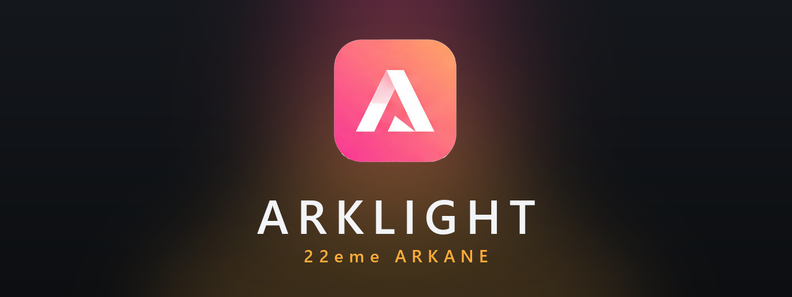

<p align="center">
  
</p>

<p align="center">
  <strong>Le simulateur lumière pour les électros et les chefs électros.</strong><br>
  Projecteurs et leurs menus en 3D, DMX, grip, plan de feu. Libre et gratuit, pour Windows.
</p>

<p align="center">
  <a href="https://github.com/22eme-Arkane/ARKLIGHT/releases/latest"><strong>Télécharger pour Windows</strong></a>
  · <a href="https://22eme-arkane.com">22eme-arkane.com</a>
  · <a href="https://paypal.me/22emearkane">Faire un don</a>
</p>

*English below.*

## Ce que fait ARKLIGHT

- **Une scène en 3D** : projecteurs, pieds, grip, décor, personnages, caméra. La lumière se voit comme sur le plateau, et le grip agit vraiment sur elle (ombres, rebonds, diffusion).
- **Les menus des projecteurs** dans l'inspecteur : claviers Astera, ARRI, Aputure, Kino Flo, Hive… touches et molettes comprises, pour s'entraîner comme sur le vrai.
- **DMX** : Luminair, Blackout ou une console pilotent les projecteurs virtuels en Art-Net ou sACN, et ils répondent au RDM. Console de test et moniteur DMX intégrés.
- **Grip** : cadres 6×6, 8×8, 12×12 et 20×20 avec toute la gamme de toiles (soies, grids, frosts, muslins, Ultrabounce, Griffolyn, lamés, noirs, tulles) et le nuancier de gélatines.
- **Plan de feu 2D** : formes, cotes, image de fond, volumes en 3D ; export PDF, PNG, SVG, MVR, liste du matériel et patch.
- **Plan dessiné sur papier** : prends-le en photo, l'assistant IA le lit et place tout sur le plan et dans la 3D. Toutes les images sont acceptées, photos HEIC de téléphone comprises.
- **Assistant IA** : AIODOS par défaut (calcul sur ton ordinateur), Ollama ou un service en ligne avec ta clé. Chaque action s'annule avec Ctrl+Z.
- **Confort** : raccourcis personnalisables avec clavier AZERTY dessiné, contrôleur MIDI, séquences et plans, français et anglais, mises à jour depuis l'application.

Ce qui n'est pas encore là : la connexion de la vraie application Astera (fausse AsteraBox Bluetooth) attend des captures sur du vrai matériel. Les sorties lumineuses des autres marques sont estimées tant qu'il n'y a pas de fiche photométrique, et les pertes des toiles sont des valeurs indicatives.

## Installer

Télécharge `ARKLIGHT-Setup-<version>.exe` dans la [dernière version](https://github.com/22eme-Arkane/ARKLIGHT/releases/latest) et lance-le. L'installeur n'est pas signé : si Windows affiche « Windows a protégé votre ordinateur », clique sur *Informations complémentaires* puis *Exécuter quand même*.

Tes projets sont rangés dans `Documents\ARKLIGHT`. Il n'y a ni compte ni abonnement, et ARKLIGHT te prévient quand une nouvelle version sort.

L'installeur propose en option **AIODOS**, l'IA locale d'ARKANE. C'est un logiciel à part : une fois installé, il relie par Internet des ordinateurs pour partager leur puissance de calcul et prête par défaut une part de ce PC au réseau public (60 % de sa puissance au plus, jamais sur batterie ; tout se coupe dans ses réglages). Les demandes d'ARKLIGHT, elles, restent sur ce PC.

## Connecter Luminair, Blackout ou une console

1. Mets le PC et la tablette sur le même réseau.
2. Dans l'appli, choisis Art-Net ou sACN, avec comme destination l'adresse IP du PC (affichée en haut de la fenêtre). Luminair trouve aussi le simulateur tout seul, sous le nom ARKLIGHT.
3. Patche les mêmes projecteurs aux mêmes adresses que dans ARKLIGHT. Par défaut, l'univers Art-Net 0 correspond à l'univers 1 du simulateur (réglable dans l'onglet *Réseau*).

## Construire depuis le code

Prérequis : [Rust](https://rustup.rs) (1.92 ou plus récent).

```
cd rust
cargo run -p arklight-desktop
cargo test --workspace
```

L'installeur demande en plus Node.js, Python avec Pillow et Inno Setup 6 : `node tools/rust/build-installer.mjs`.

```
rust/crates/
  arklight-core      projet, bibliothèque, moteur de lumière, annuler / rétablir
  arklight-render    vue 3D (wgpu)
  arklight-net       Art-Net, sACN, RDM
  arklight-onboard   menus embarqués des projecteurs
  arklight-plot      plan de feu, exports
  arklight-midi      contrôleur MIDI
  arklight-ai        assistant IA, AIODOS
  arklight-ble       Bluetooth
  arklight-desktop   application (Slint)
shared/, web/, server/, desktop/   version JavaScript d'origine : shared/ reste la source de la bibliothèque
```

La version JavaScript d'origine, ses tests et le détail des modèles Astera sont décrits dans [docs/VERSION-JS.md](docs/VERSION-JS.md).

## English

**ARKLIGHT** is a lighting simulator for gaffers and electricians: fixtures with their on-board menus in 3D, Art-Net / sACN / RDM, grip that really acts on the light (with the full range of frame cloths), 2D lighting plots with exports, and an AI assistant that rebuilds a plan drawn on paper from a photo. Free, for Windows, in French and English.

[Download the installer](https://github.com/22eme-Arkane/ARKLIGHT/releases/latest). It isn't signed: if Windows shows "Windows protected your PC", click *More info*, then *Run anyway*.

## Licence

Copyright © 2026 22eme ARKANE. Logiciel libre sous licence [Apache-2.0](LICENSE) ; composants tiers dans [NOTICE](NOTICE). Non affilié aux fabricants cités.

Les versions publiées jusqu'à 0.1.0-alpha.1 restent sous GPL-3.0.

<a href="https://slint.dev"></a>
